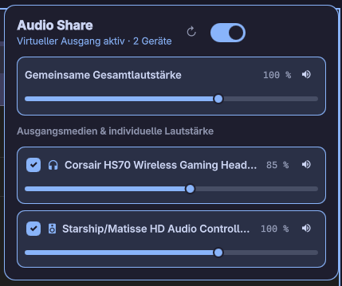
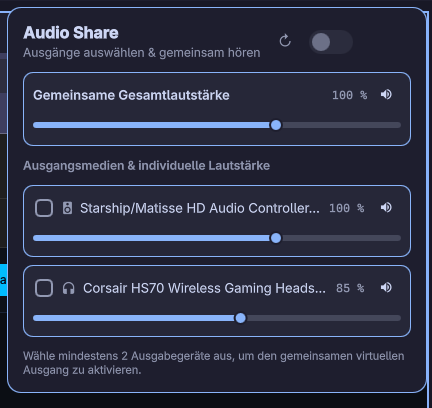

# Audio Share

An Omarchy bar widget to combine two or more PipeWire audio outputs into one virtual output, with independent volume and mute controls for every device.

<p>
  
  
</p>

## Install

Via **Omarchy Plugin Store** (`Super + Space`) or CLI:

```bash
omarchy plugin add https://github.com/Beginner2026-de/Audio-Share.git --enable
omarchy restart shell
```

## Usage

1. Click the dual-headphones icon in the top bar.
2. Select 2 or more output devices.
3. Toggle the switch at the top right to enable shared playback and adjust individual volumes.

## Update & Remove

```bash
# Update
omarchy plugin update io.github.beginner2026-de.audio-share && omarchy restart shell

# Remove
omarchy plugin disable io.github.beginner2026-de.audio-share
omarchy plugin remove io.github.beginner2026-de.audio-share
omarchy restart shell
```

## License

MIT — [LICENSE](LICENSE)
